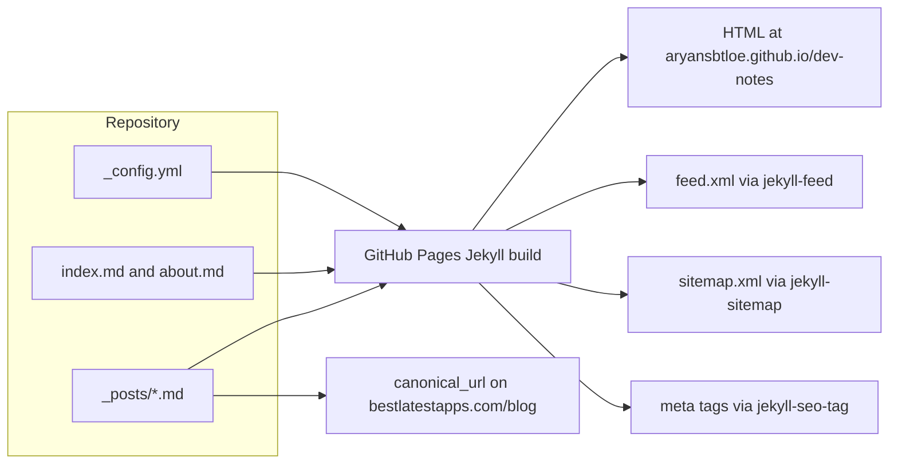

# Alok Singh – App Dev Notes

[](https://github.com/aryansbtloe/dev-notes)
[](LICENSE)
[](https://aryansbtloe.github.io/dev-notes/)

Practical, code-first notes on iOS and Android app development, published as a Jekyll site. The home page describes the collection as notes by Alok Singh, and each article was originally published at [bestlatestapps.com/blog](https://bestlatestapps.com/blog/). This repository is the GitHub Pages source for that mirror. GitHub Pages builds the `main` branch and serves it at [https://aryansbtloe.github.io/dev-notes/](https://aryansbtloe.github.io/dev-notes/).

The site configuration names Swift, SwiftUI, SpriteKit, AVFoundation, notifications, offline-first architecture, and shipping apps to the stores. The 54 posts currently in `_posts/` fall into two series: iOS engineering write-ups (28 September 2026 through 21 October 2026) and browser-tool how-to guides (27 October 2026 through 10 November 2026). There is no separate Android-tagged post in the tree today.

## Features

- Jekyll site using the [minima](https://github.com/jekyll/minima) theme, with `index.md` as the post list (`layout: home`) and `about.md` linked from the header.
- 54 Markdown posts. Every post sets `layout: post`, `title`, `date`, `author: Alok Singh`, `canonical_url`, and `tags`, then opens with an "Originally published at bestlatestapps.com" line and a `` block so code samples are not parsed as Liquid.
- iOS engineering posts include Swift snippets and, where the article uses one, an app icon loaded from `bestlatestapps.com`. They do not set a `description` field.
- Tool how-to posts add a `description` field and are tagged `tools` and `howto`. They cover in-browser utilities (PDF, images, audio, JWT, provisioning profiles, privacy manifests, and similar) plus a few explainers such as BMI, cron, GSTIN/PAN, and salary.
- Plugins declared in `_config.yml`: `jekyll-seo-tag`, `jekyll-feed`, and `jekyll-sitemap`.
- Permalinks of the form `/:year/:month/:day/:title/`, so a post dated 2026-10-21 with title slug `tic-tac-toe-in-swiftui-done-properly` is published at `/dev-notes/2026/10/21/tic-tac-toe-in-swiftui-done-properly/`.
- A header link to the About page, and a minima social link to [https://bestlatestapps.com/alok/](https://bestlatestapps.com/alok/).
- `.gitignore` excludes Jekyll's local output: `_site/`, `.jekyll-cache/`, and `.sass-cache/`.

## Architecture

GitHub Pages runs Jekyll against this repository. `_config.yml` selects the theme, the site URL, the `/dev-notes` base URL, the permalink shape, and the three plugins. Posts and the two top-level pages are the only content sources. Each post keeps a `canonical_url` pointing back at the original article on bestlatestapps.com.



## Requirements

The live site does not need a local toolchain. GitHub Pages is already enabled for this repository, building the `main` branch from the repository root.

To preview locally you need:

- Ruby and RubyGems
- Jekyll, plus the gems named in `_config.yml`: `minima`, `jekyll-seo-tag`, `jekyll-feed`, and `jekyll-sitemap`

This repository does not commit a `Gemfile` or `Gemfile.lock`. Those four gems are what the config asks Jekyll to load, and they are the same theme and plugins GitHub Pages uses to build the site.

## Installation

Clone the repository and install the theme and plugins declared in `_config.yml`:

```bash
git clone https://github.com/aryansbtloe/dev-notes.git
cd dev-notes
gem install jekyll minima jekyll-seo-tag jekyll-feed jekyll-sitemap
```

Serve the site with the configured base URL (`/dev-notes`):

```bash
jekyll serve
```

Open [http://127.0.0.1:4000/dev-notes/](http://127.0.0.1:4000/dev-notes/). The About page is at `/dev-notes/about/`.

There is no build script, CI workflow, or extra install step in the repository. Publishing happens when a commit lands on `main` and GitHub Pages rebuilds.

## Usage

Read the published site at [https://aryansbtloe.github.io/dev-notes/](https://aryansbtloe.github.io/dev-notes/).

A new article is a Markdown file in `_posts/` whose name is `YYYY-MM-DD-slug.md`. Match the front matter of the series you are extending.

An iOS engineering post:

```markdown
---
layout: post
title: "Post title"
date: 2026-10-21 09:00:00 +0000
author: Alok Singh
canonical_url: "https://bestlatestapps.com/blog/post-slug/"
tags: [ios, swift]
---
Originally published at [bestlatestapps.com](https://bestlatestapps.com/blog/post-slug/).


Article body.

```

A tool how-to also sets `description`. Recent posts in that series use a `+0530` offset on `date`; the iOS series uses `+0000`. Jekyll takes the filename date together with this `date` field, and the permalink uses the title slug rather than the whole filename.

`index.md` is the home page (`layout: home`, `list_title: Articles`). `about.md` is a page (`layout: page`, `permalink: /about/`) and is listed under `header_pages` in `_config.yml`.

## Project structure

```text
.
├── _config.yml          # Site title, URL, minima theme, plugins, permalinks
├── _posts/              # One Markdown file per article (54 posts)
│   └── YYYY-MM-DD-slug.md
├── about.md             # About page, linked from the header
├── index.md             # Home page and article list
├── .gitignore           # Ignores _site/, .jekyll-cache/, .sass-cache/
├── LICENSE              # MIT License
└── README.md
```

Jekyll writes `_site/` when you build locally. That directory is gitignored, and it is not part of the repository.

## Posts

### iOS engineering notes

| Date | Title | Tags |
| --- | --- | --- |
| 2026-09-28 | A Document Scanner in an Afternoon: VisionKit's Camera, Core Image Clean-Up and AirPrint | ios, swift, visionkit, core-image, uikit |
| 2026-09-29 | A Practical Guide to iOS Haptics: UIFeedbackGenerator, SwiftUI sensoryFeedback and Core Haptics with AHAP | ios, swift, swiftui, notifications, haptics, uikit, games |
| 2026-09-30 | Animating Algorithms in SwiftUI: A Step-Recorder Pattern for Visualising Sorts, Searches and Graphs | ios, swift, swiftui |
| 2026-10-01 | Building a Chromatic Guitar Tuner on iOS: Real-Time Pitch Detection with AVAudioEngine and Accelerate | ios, swift, avaudioengine, audio |
| 2026-10-02 | Building a Hashtag Copier for iOS: Clean Tags, Editable Lists, Clipboard Privacy and Instagram's New Five-Hashtag Limit | ios, swift |
| 2026-10-03 | Building a Live Temple Darshan App for iOS: HLS Streaming, Picture-in-Picture, Time-Zone-Correct Aarti Reminders and Notification Actions | ios, swift, swiftui, notifications, offline-first, audio |
| 2026-10-04 | Building a Live iOS Component Catalogue: UIKit and SwiftUI Side by Side, Real Demos, and Code Snippets That Don't Rot | ios, swift, swiftui, uikit |
| 2026-10-05 | Building a Low-Latency Virtual Piano and Drum Kit on iOS with AVAudioEngine | ios, swift, avaudioengine, avfoundation, uikit, audio, games |
| 2026-10-06 | Building a Real-Time Mic-to-Speaker App on iOS with AVAudioEngine | ios, swift, avaudioengine, uikit, audio |
| 2026-10-07 | Building a Tap-to-Match Marble Game with SpriteKit and SwiftUI: Physics, Cluster Matching, Timers, Lives and Power-Ups | ios, swift, swiftui, spritekit, gamecenter, games |
| 2026-10-08 | Building an AdMob Earnings Dashboard for iOS: Google OAuth with PKCE, the AdMob Reporting API, Pacific-Time 'Today', and Offline Caching | ios, swift, admob, offline-first, uikit, security |
| 2026-10-09 | Building an Offline Quotes App in SwiftUI: a 50,000-Quote Library, a Daily Quote Without a Server, Honest Streaks and Share-as-Image | ios, swift, swiftui, offline-first |
| 2026-10-10 | Building an Offline eBook Reader for iOS: Downloads, Typography Settings, Reading Progress That Survives Font Changes, and Highlights in the iOS 26 Text APIs | ios, swift, offline-first, networking |
| 2026-10-11 | Building an Offline-First Bible Reader on iOS: Bundled SQLite, Full-Text Search and iCloud-Synced Notes | ios, swift, core-data, offline-first |
| 2026-10-12 | Convert-As-You-Type Currency Conversion in Swift: Decimal Maths, Cached Rates and Locale-Aware Formatting | ios, swift, swiftui |
| 2026-10-13 | Drag-to-Connect and Game Center Leaderboards in a SwiftUI Puzzle Game, Updated for iOS 26 | ios, swift, swiftui, spritekit, gamecenter, games |
| 2026-10-14 | From Barcode to PDF: Building a Private, Offline Medication Tracker with VisionKit, WidgetKit and PDFKit | ios, swift, swiftui, notifications, visionkit, offline-first, pdf |
| 2026-10-15 | Medication Reminders That Actually Fire: Local Notifications, the 64-Notification Limit and Supply Math | ios, swift, notifications |
| 2026-10-16 | Shipping a 4K Wallpaper App Without Running Out of Memory: ImageIO Downsampling, Core Image Blur and Add-Only Photos Access | ios, swift, swiftui, core-image, imageio, uikit, networking |
| 2026-10-17 | Stop Hand-Rolling Unit Conversions: Foundation's Measurement, Dimension and MeasurementFormatter in Practice | ios, swift, offline-first |
| 2026-10-18 | Text Plus Audio, Fully Offline: Building a Prayer App with AVAudioPlayer and Lock-Screen Controls | ios, swift, avfoundation, offline-first, uikit, audio |
| 2026-10-19 | The Device Side of APNs: Building a Push Notification Test Client in Swift | ios, swift, swiftui, push-notifications, notifications, uikit |
| 2026-10-20 | The Sending Side of APNs: A Mac Push Tester with Keychain Certificates, URLSession Client Auth and HTTP/2 | ios, swift, push-notifications, notifications, security, networking |
| 2026-10-21 | Tic Tac Toe in SwiftUI, Done Properly: Value-Type Game State, Win Detection and an Unbeatable Minimax Opponent | ios, swift, swiftui, uikit, games |

### Browser tool guides

| Date | Title |
| --- | --- |
| 2026-10-27 | Background Removal in the Browser: U2-Net on ONNX Runtime Web, a Zoomed Second Pass and a Guided-Filter Matte |
| 2026-10-27 | How to Decode and Verify a JWT in Your Browser (Without Pasting It Into a Server) |
| 2026-10-27 | Generating Swift Codable Types from JSON in the Browser: Number Literals, Optional Merging and the convertFromSnakeCase Rules |
| 2026-10-27 | Reading a .mobileprovision File in the Browser: Finding the Plist, Parsing It Without a DOM, and Decoding Certificates by Hand |
| 2026-10-27 | Redacting a PDF So the Text Is Really Gone: Rebuilding Pages with pdf.js and pdf-lib, Then Checking the Result |
| 2026-10-27 | Writing PrivacyInfo.xcprivacy Without Guesswork: How My Browser-Based Privacy Manifest Generator Models Apple's Rules |
| 2026-10-28 | How to Cut an MP3 and Make a Ringtone in Your Browser |
| 2026-10-28 | How to Remove Location and EXIF Data From Photos Before You Share Them |
| 2026-10-28 | Why Your Universal Links Open Safari: Validating the apple-app-site-association File |
| 2026-11-02 | How to Calculate Exact Age in Years, Months and Days |
| 2026-11-02 | How to Convert CSV to Excel (and Keep Leading Zeros and Numbers Intact) |
| 2026-11-02 | How to Test Your Internet Speed (and What the Numbers Mean) |
| 2026-11-03 | How Islamic Prayer Times Are Calculated (and Why Methods Differ) |
| 2026-11-03 | How to Upscale an Image 2× or 4× With AI, Right in Your Browser |
| 2026-11-03 | Play Minesweeper Online: How to Read the Numbers and Win |
| 2026-11-06 | CTC to In-Hand Salary: How to Work Out Your Monthly Take-Home in India |
| 2026-11-06 | How to Compress a PDF Without Uploading It |
| 2026-11-06 | How to Extract Text From an Image or Screenshot (English and Hindi) |
| 2026-11-07 | How to Generate an APNs JWT Provider Token From a .p8 Key |
| 2026-11-07 | How to Make a Professional Invoice for Free (PDF, With Your Logo) |
| 2026-11-07 | How to Test a robots.txt File: Is This URL Allowed? |
| 2026-11-08 | App Store Character Limits: How to Count Your Name, Subtitle and Keywords |
| 2026-11-08 | How to Balance Chemical Equations (and Check the Atoms) |
| 2026-11-08 | How to Convert an iPhone MOV Video to MP4 Without Losing Quality |
| 2026-11-09 | How to Read and Write Cron Expressions (With Next Run Times) |
| 2026-11-09 | How to Test Your Microphone Online Before a Call |
| 2026-11-09 | How to Test Your Typing Speed (WPM) and Accuracy |
| 2026-11-10 | How to Calculate Your BMI (and What It Doesn't Tell You) |
| 2026-11-10 | How to Check a GSTIN or PAN Number: Format, State Code and Check Digit |
| 2026-11-10 | Play Klondike Solitaire Online: Rules and Winning Tips |

Every guide in this second table is tagged `tools, howto` and includes a `description` in its front matter.

## Configuration

All site settings live in `_config.yml`:

| Key | Value |
| --- | --- |
| `title` | Alok Singh – App Dev Notes |
| `author` | Alok Singh |
| `description` | Practical, code-first notes on iOS and Android app development: Swift, SwiftUI, SpriteKit, AVFoundation, notifications, offline-first architecture and shipping apps to the stores. |
| `url` | `https://aryansbtloe.github.io` |
| `baseurl` | `/dev-notes` |
| `theme` | `minima` |
| `plugins` | `jekyll-seo-tag`, `jekyll-feed`, `jekyll-sitemap` |
| `permalink` | `/:year/:month/:day/:title/` |
| `minima.social_links` | Portfolio link to `https://bestlatestapps.com/alok/` (icon `rss`) |
| `header_pages` | `about.md` |

There are no environment variables, API keys, or additional config files in the repository.

## Contributing

Issues and pull requests are welcome for corrections to existing notes, new posts that follow the front matter above, and fixes to `_config.yml`.

- Put new articles in `_posts/` using the `YYYY-MM-DD-slug.md` filename.
- Keep `author: Alok Singh` and a `canonical_url` when the article also lives on bestlatestapps.com.
- Wrap bodies that contain Liquid-sensitive characters (`{{` or `{%`) in ` ... `, which is what the current posts do.
- Do not commit `_site/`, `.jekyll-cache/`, or `.sass-cache/`.

## License

MIT. Copyright (c) 2026 Alok Singh. See [LICENSE](LICENSE).

## Author

Alok Singh

- GitHub: [https://github.com/aryansbtloe](https://github.com/aryansbtloe)
- Portfolio: [https://bestlatestapps.com](https://bestlatestapps.com)
